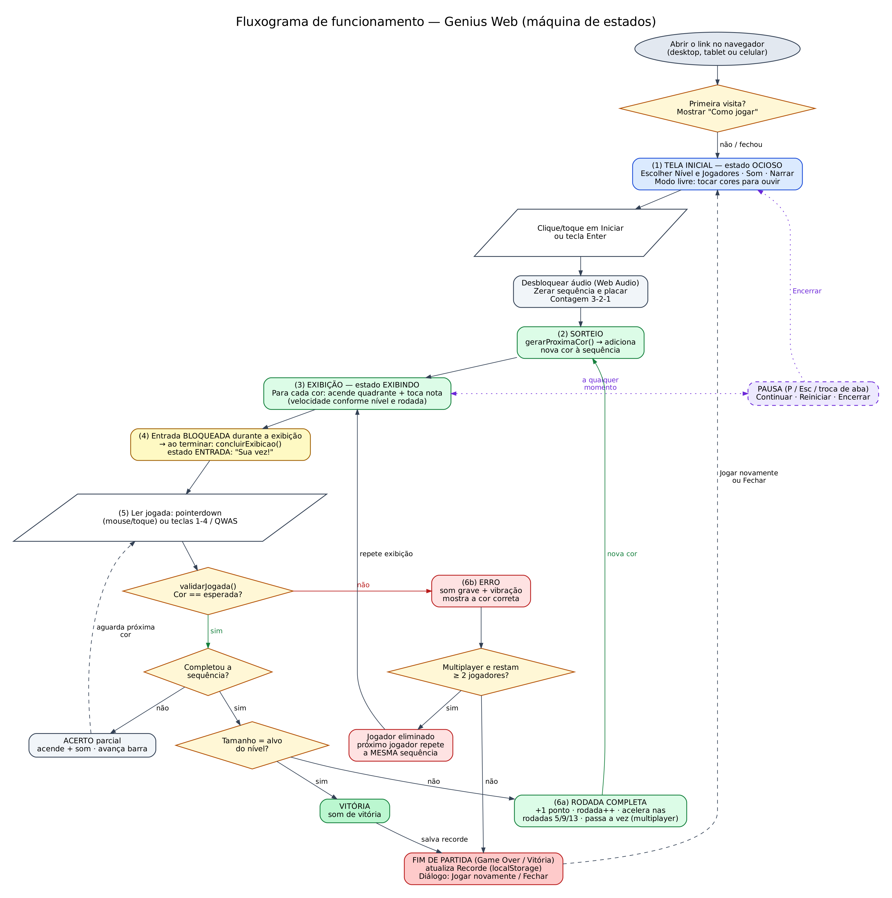
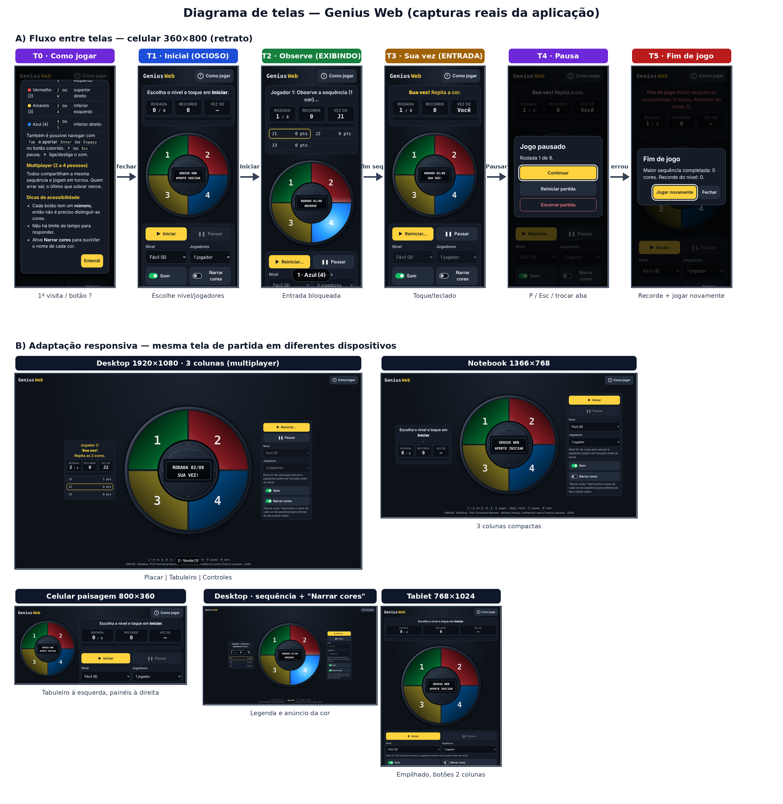

# Desenvolvimento de Interface Web Responsiva para o Jogo Genius

UNICAP · Disciplina de Design de Interface e Usabilidade · Versão de 20/11/2026

**GeniusWeb UNICAP: Jogo Interativo Multiplataforma, Acessível e Multiplayer**

Modelo de documentação e entrega de projeto acadêmico. Disciplina de Design de Interface e Usabilidade: especificação, design de interface web, requisitos e TDD. Dezembro de 2026.

| Item | Informação |
| --- | --- |
| Instituição / Disciplina | Universidade Católica de Pernambuco (UNICAP), Disciplina de Design de Interface e Usabilidade |
| Professor(a) Responsável | Prof. Emmanuel Barreto |
| Equipe de Alunos | \[Nome do Grupo\]: Adriano Araújo, Guilherme Larré e Franciscleide Lauriano |
| Plataforma Exigida | Ambiente Web Responsivo (Desktops, Notebooks, Tablets e Celulares) com Link Online |
| Link do Jogo | https://guilarre.github.io/projeto\_multiplayer-genius\_web/ |
| Data Limite de Entrega | 12 de dezembro de 2026, Recife (PE) |

## 1. Apresentação da Instituição, Equipe e Escopo Técnico

Este documento apresenta a especificação técnica, a arquitetura de interface, os requisitos funcionais e não-funcionais, os testes orientados a TDD e os artefatos de implementação do Genius Web: uma interface web responsiva, acessível e multiplayer (1 a 4 jogadores) para o jogo de memória sequencial Genius. Os requisitos seguem a estrutura da norma IEEE 830 (Especificação de Requisitos de Software) e a interface foi avaliada pelas 10 heurísticas de usabilidade de Nielsen e pelas diretrizes WCAG 2.2.

### 1.1 Dados Institucionais e da Disciplina

| Item | Informação Institucional |
| --- | --- |
| Instituição de Ensino | Universidade Católica de Pernambuco (UNICAP) |
| Disciplina | Design de Interface e Usabilidade |
| Professor(a) Responsável | Prof. Emmanuel Barreto |
| Turma / Período Letivo | \[Turma\] / 2026.2 |
| Data de Entrega | 12 de dezembro de 2026 |

### 1.2 Apresentação dos Alunos (Equipe de Desenvolvimento)

| Integrante | Nome Completo | Matrícula / RA | CPF | Data Nasc. | Papel no Projeto Web |
| --- | --- | --- | --- | --- | --- |
| Aluno 1 | Adriano Araújo | \[000000000\] | \[000.000.000-00\] | \[DD/MM/AAAA\] | Design de interface (tabuleiro SVG) |
| Aluno 2 | Guilherme Larré ([github.com/guilarre](https://github.com/guilarre)) | \[000000000\] | \[000.000.000-00\] | \[DD/MM/AAAA\] | Líder / Lógica do jogo em JavaScript, testes TDD, repositório e deploy no GitHub Pages |
| Aluno 3 | Franciscleide Lauriano ([github.com/francisLauriano](https://github.com/francisLauriano)) | 860720 | \[000.000.000-00\] | \[DD/MM/AAAA\] | CSS responsivo, áudio web, acessibilidade e testes TDD |

**Breve apresentação da equipe e divisão de atividades:** a equipe partiu de conhecimentos de HTML, CSS e JavaScript, lógica de programação e noções de UX/UI. A primeira versão do jogo foi portada da lógica de um protótipo em Arduino (C++) e já tinha o tabuleiro SVG desenhado em ferramenta de design vetorial e o modo multiplayer. Na segunda fase, o trabalho foi dividido em três frentes que se integram pelo repositório Git: (1) lógica do jogo, repositório e publicação no GitHub Pages, com Guilherme Larré; (2) CSS responsivo, áudio web e acessibilidade, com Franciscleide Lauriano; (3) design de interface e tabuleiro SVG, com Adriano Araújo. Os testes TDD ficaram com Guilherme Larré e Franciscleide Lauriano. O código-fonte e o histórico de commits ficam no repositório de Guilherme Larré no GitHub.

### 1.3 Diretrizes Obrigatórias da Solução Web

| Diretriz mandatória | Como o Genius Web atende |
| --- | --- |
| Ambiente web nativo | Roda direto no navegador, sem instalação nem plugins: HTML5, CSS3 e JavaScript puro, sem framework e sem etapa de build. |
| Portabilidade multi-dispositivo | Layout mobile-first com CSS Grid e media queries para celular (retrato e paisagem), tablet, notebook e desktop. Validado em 6 tamanhos de tela, de 360×800 a 1920×1080. |
| Interação híbrida (mouse, teclado e toque) | Pointer Events (`pointerdown`) atendem mouse, caneta e toque com resposta imediata. Teclas 1–4 ou Q/W/A/S jogam, e Tab mais Enter/Espaço permite jogar só pelo teclado. |
| Disponibilização online | Site estático publicado no GitHub Pages via HTTPS, com acesso direto e sem login (Seção 4.1). |

## 2. Documento de Requisitos (Baseado nas Quests)

### 2.1 Quest 1: Entendimento do Contexto

**Ambiente de uso e dispositivos-alvo.** O Genius Web é acessado por um link, em quatro cenários principais:

- **Laboratório com desktops:** mouse e teclado, monitores de 1366 a 1920 px ou mais, alto-falantes compartilhados ou fones. Nesse ambiente o som pode incomodar, então há chave Som On/Off e tecla M.
- **Notebook pessoal:** tela de 1366×768 com pouca altura útil. O tabuleiro se limita pela altura (74% da janela) para nunca exigir rolagem.
- **Tablet em sala de aula:** toque, retrato ou paisagem, possivelmente compartilhado entre 2 a 4 alunos. Por isso existe o modo multiplayer local por turnos.
- **Celular em trânsito:** tela a partir de 360 px, uso com uma mão, iluminação externa forte, som muitas vezes desligado e conexão instável. O jogo não depende de áudio para ser jogável, o tabuleiro tem alto contraste aceso/apagado e a página pesa poucos KB, sem arquivos de áudio para baixar.

**Público-alvo e usuários.** Estudantes e público geral de 7 a 70+ anos, incluindo:

- **Crianças e iniciantes:** precisam de instruções curtas, nível fácil e mensagens diretas ("Observe", "Sua vez!").
- **Idosos e pessoas com baixa visão:** precisam de fontes de no mínimo 16 px, áreas de toque grandes e ritmo mais lento.
- **Pessoas com daltonismo (cerca de 8% dos homens):** não podem depender só da cor. Cada botão tem número (1–4) e posição fixa.
- **Pessoas com deficiência auditiva:** todo som tem equivalente visual.
- **Pessoas com deficiência motora ou que usam teclado:** precisam jogar sem mouse e sem limite de tempo.
- **Usuários de leitor de tela:** precisam de rótulos ARIA e anúncio das mudanças de estado. Para eles há o modo "Narrar cores".
- **Pessoas fotossensíveis:** o jogo nunca pisca mais de 3 vezes por segundo (WCAG 2.3.1).

### 2.2 Quest 2: Definição do Problema

**Declaração do problema.** As versões web comuns do Genius funcionam bem só no computador. No celular o layout quebra ou exige rolagem e o toque responde com atraso de 300 ms. O som atrasa ou não toca no iOS. Além disso, o jogo só é jogável por quem enxerga bem as cores e usa mouse. A primeira versão da própria equipe tinha tabuleiro fixo de 400 px, não tinha som, placar nem recorde, e o menu de pausa era uma lista sem acesso pelo teclado.

**Limitações das soluções convencionais:**

- **Brinquedo físico:** não é portátil para a sala inteira, não guarda recorde e não tem recursos de acessibilidade.
- **Interfaces web não responsivas:** tabuleiro cortado em telas menores que 400 px, rolagem horizontal e botões pequenos demais para o dedo.
- **Identificação só por cor:** exclui pessoas daltônicas (viola a WCAG 1.4.1).
- **Sem teclado nem leitor de tela:** os quadrantes são `div`s sem foco e sem rótulo.
- **Limite de tempo rígido para responder:** penaliza pessoas com deficiência motora (WCAG 2.2.1).
- **Pouco feedback:** o jogador não sabe se é a vez dele, em que rodada está nem qual cor errou.

### 2.3 Quest 3: Ideação, Proposta de Solução e Referência Visual

**Conceito da solução web.** O tabuleiro reproduz o Genius clássico da Figura 1 em SVG vetorial: quatro quadrantes em círculo (Verde, Vermelho, Amarelo e Azul em sentido horário) e um console central com display LCD. O SVG escala sem perder nitidez de 280 px a 760 px. Cada quadrante tem uma versão "apagada" (gradiente escuro) e uma "acesa" (gradiente radial claro com brilho), e alternar entre elas cria o efeito de LED. As notas são geradas pela Web Audio API nas frequências do Genius original. Os controles do aparelho foram traduzidos assim:

| Controle do Genius original (Figura 1) | Equivalente no Genius Web |
| --- | --- |
| Botão Start | Botão Iniciar (ou tecla Enter) |
| Botão Last / Replay | Pausa com opção Continuar, que reapresenta a sequência |
| Botão Longest | Recorde por nível salvo no navegador |
| Chave Skill 1–4 | Seletor de Nível: 8, 14, 20 ou 31 cores |
| Chave Game (modos de jogo) | Seletor de Jogadores: 1 a 4 |
| Chave Sound On/Off | Chave Som (ou tecla M) |
| Contador digital | Display LCD central e placar (Rodada, Recorde, Vez de) |

**Proposta de valor.** O jogador abre um link e joga na hora, em qualquer aparelho e com o que tiver à mão: dedo, mouse ou teclado. A resposta audiovisual é imediata, o recorde fica salvo e o jogo explica o erro ("a cor certa era Azul (4)").

**Proposta Única de Valor (PUV).** Um Genius que todos na sala conseguem jogar juntos: multiplayer local de até 4 pessoas no mesmo aparelho e acessibilidade completa (números além das cores, teclado, leitor de tela com narração das cores, sem limite de tempo e seguro para fotossensíveis), sem abrir mão do visual do aparelho clássico. A lógica separada da interface e coberta por testes também serve de exemplo didático de TDD.

### 2.4 Quest 4: Requisitos do Sistema Web (RF, RNF e RTEC)

Os requisitos seguem a IEEE 830-1998. Cada requisito tem identificador único, prioridade e critério de aceite verificável, e é rastreável até um teste da Seção 2.5 (coluna Teste). A tabela abaixo mostra onde cada parte da norma aparece neste documento.

| Seção da IEEE 830 | Onde está neste documento |
| --- | --- |
| 1. Introdução: propósito, escopo, definições, referências | Seções 1 e 6, e o glossário abaixo |
| 2. Descrição geral: perspectiva, funções, usuários, restrições, premissas | Quests 1 a 3 (2.1 a 2.3) |
| 3. Requisitos específicos: funcionais, desempenho, atributos, interfaces | Tabelas RF, RNF e RTEC abaixo |
| Características de qualidade: correto, não ambíguo, verificável, rastreável, priorizado | Critério mensurável por requisito, coluna Teste e prioridade MoSCoW |

**Glossário.** *Sequência*: lista de cores sorteadas. *Rodada*: tamanho atual da sequência. *Alvo*: número de cores para vencer no nível. *Fase*: estado da máquina de estados (OCIOSO, EXIBINDO, ENTRADA, GAME\_OVER, VITORIA). *Prioridade MoSCoW*: Must (obrigatório), Should (importante), Could (desejável).

**Premissas e restrições.** Navegador com suporte a ES2017, Pointer Events e `<dialog>` (Chrome/Edge 37+, Firefox 98+, Safari 15.4+). Sem servidor de aplicação: todos os dados ficam no navegador do jogador.

**1. Requisitos Funcionais (RF):**

| ID | Categoria | Descrição do Requisito | Prioridade | Critério de Aceite | Teste |
| --- | --- | --- | --- | --- | --- |
| RF-01 | Sequência Aleatória | Gerar sequência pseudoaleatória incremental de cores (Verde, Vermelho, Amarelo, Azul), acrescentando uma cor a cada rodada concluída. | Alta (Must) | Sequência gerada dinamicamente, sem repetição fixa entre partidas, suportando ≥ 20 rodadas (até 31 no nível Expert). | TST-05 |
| RF-02 | Feedback Audiovisual | Iluminar o quadrante correspondente (efeito brilho/ativo) e reproduzir nota sonora distinta simultaneamente. | Alta (Must) | Sincronia entre destaque visual e áudio em 100% das etapas da sequência. Notas: 415, 310, 252 e 209 Hz. | TST-03 |
| RF-03 | Validação de Jogadas | Capturar a interação do usuário (clique, toque ou tecla), comparar com a sequência esperada e avançar ou encerrar a partida. Bloquear entradas durante a exibição. | Crítica (Must) | Reconhecimento imediato de acerto (próxima rodada) ou erro (Game Over). Entradas fora da vez são ignoradas. | TST-01 |
| RF-04 | Controles e Placar | Disponibilizar Iniciar/Reiniciar, Pausar, Som On/Off, seletor de Nível e placar (Rodada, Recorde, Vez de). | Alta (Must) | Todos os controles operantes e placar atualizado em tempo real. | TST-04 |
| RF-05 | Multiplayer Local | Permitir partidas de 1 a 4 jogadores em turnos no mesmo aparelho. Quem erra é eliminado e o próximo repete a mesma sequência. Vence o último restante. | Alta (Must) | Vez passa ao próximo jogador ativo, eliminados são pulados e o vencedor é exibido no ranking final. | TST-07 |
| RF-06 | Níveis e Velocidade | Oferecer 4 níveis (alvo de 8, 14, 20 e 31 cores, como a chave Skill original), acelerando 12% nas rodadas 5, 9 e 13. | Média (Should) | Ao completar o alvo, o jogo declara vitória. Intervalos diminuem nos marcos. | TST-05, TST-08 |
| RF-07 | Pausa | Pausar por botão, tecla P/Esc ou troca de aba, com as opções Continuar, Reiniciar e Encerrar. | Média (Should) | Exibição interrompida em ≤ 50 ms. Ao continuar, a sequência é reapresentada. | TST-06 |
| RF-08 | Explicação do Erro | Ao errar, informar qual cor era a correta e qual foi tocada, e acender a cor correta. | Média (Should) | Mensagem do tipo "A cor certa era Azul (4); você tocou Vermelho (2)". | TST-01 |
| RF-09 | Ajuda e Atalhos | Exibir "Como jogar" na primeira visita e pelo botão "?", com regras, tabela de atalhos e dicas de acessibilidade. | Média (Should) | Abre automaticamente só na 1ª visita e fecha com Esc ou Entendi. Durante a partida, pausa o jogo e, ao fechar, volta ao diálogo de pausa. | TST-06 |

**2. Requisitos Não-Funcionais (RNF):**

| ID | Categoria | Descrição do Requisito | Prioridade | Critério de Aceite | Teste |
| --- | --- | --- | --- | --- | --- |
| RNF-01 | Portabilidade e Responsividade | A interface deve adaptar-se a desktops, notebooks, tablets e celulares (retrato e paisagem). | Crítica (Must) | Sem quebra de layout nem scroll horizontal de 360 px até 1920 px ou mais. Tabuleiro sempre quadrado e inteiro na tela. | TST-02 |
| RNF-02 | Interação Touch e Mouse | Os botões coloridos devem suportar toque e clique sem o atraso de 300 ms. | Crítica (Must) | Resposta visual e sonora < 50 ms, sem disparo duplo. | TST-03 |
| RNF-03 | Compatibilidade Web | Funcionar no Google Chrome, Microsoft Edge, Firefox e Safari (mobile e desktop). | Alta (Must) | Execução sem erros de console nos navegadores testados. | TST-02 |
| RNF-04 | Usabilidade e Acessibilidade | Área mínima de toque de 48×48 px, alto contraste entre aceso e apagado, e mensagens claras. | Alta (Must) | Todos os controles com no mínimo 48 px. Contraste de texto ≥ 4,5:1 (texto principal ≥ 10:1). Aprovação em teste de usabilidade. | TST-02, TST-10 |
| RNF-05 | Segurança Fotossensível | Nunca piscar mais de 3 vezes por segundo (WCAG 2.3.1). | Crítica (Must) | Ciclo aceso + apagado ≥ 350 ms em todos os níveis e rodadas (no máximo 2,86 Hz). | TST-08 |
| RNF-06 | Acessibilidade WCAG 2.2 AA | Jogável só por teclado, com foco visível, rótulos ARIA, números além das cores, anúncios em `aria-live` e sem limite de tempo. Respeita `prefers-reduced-motion` e `prefers-contrast`. | Alta (Must) | Partida completa só com Tab, Enter e Espaço. Leitor de tela anuncia rodada, vez e erro. | TST-06, TST-10 |
| RNF-07 | Desempenho | Carregamento leve e sem dependências. | Média (Should) | HTML + CSS + JS com menos de 100 KB sem compressão (medido: 81 KB) e nenhum arquivo de áudio ou imagem externo. | TST-09 |
| RNF-08 | Manutenibilidade | Lógica separada da interface, em funções puras comentadas em português. | Média (Should) | 100% das regras de jogo cobertas por testes unitários automatizados. | TST-01, TST-05 |

**3. Requisitos Técnicos de Arquitetura Web e Hospedagem (RTEC):**

| ID | Camada / Recurso | Especificação Técnica | Justificativa Técnica |
| --- | --- | --- | --- |
| RTEC-01 | Front-End Web | HTML5 semântico (`header`, `main`, `section`, `dialog`), CSS3 (Grid, Flexbox, media queries, unidades `vw`/`dvh`/`rem`, `aspect-ratio`) e JavaScript ES2017 sem framework. | Portabilidade nativa e fluidez entre celular, tablet e desktop, sem etapa de build. |
| RTEC-02 | Motor de Áudio | Web Audio API com osciladores triangulares e envelope de ganho, desbloqueada no primeiro toque. | Sem atraso de carregamento e compatível com navegadores móveis (Android/iOS). |
| RTEC-03 | Persistência Local | `localStorage` (chave `geniusweb:v1`) para recorde por nível e preferências de som, narração, nível e jogadores, com `try/catch`. | Mantém o recorde após fechar ou atualizar a página, inclusive com falha em modo anônimo. |
| RTEC-04 | Hospedagem e Link Online | Deploy estático via HTTPS no GitHub Pages, com acesso direto e sem login. | Professor e avaliadores testam imediatamente em qualquer dispositivo. |
| RTEC-05 | Arquitetura | `genius-core.js` (máquina de estados, funções puras, padrão UMD) separado de `genius-ui.js` (DOM, áudio, eventos). | Permite testar as regras no Node.js sem navegador (TDD). |
| RTEC-06 | Gráficos | Tabuleiro em SVG inline com quadrantes `role="button"` e `tabindex="0"`, e dois estados (aceso/apagado) por quadrante. | Nitidez em qualquer resolução, acessível e animável com CSS. |
| RTEC-07 | Testes e CI | `node:test` para testes unitários, Playwright para testes de interface em 6 viewports e GitHub Actions rodando os testes a cada push. | Ciclo TDD automatizado e regressões detectadas antes do deploy. |

### 2.5 Quest 5: Validação e Testes Orientados a TDD

Todos os 36 testes automatizados passam: 12 unitários da lógica e 24 verificações de interface em 8 tamanhos de tela (execução de 22/11/2026). Faltam apenas as duas verificações manuais em aparelho real e com leitor de tela, marcadas como Pendente.

O ciclo TDD foi aplicado assim:

1. **Red (teste da lógica):** os testes de `tests/genius-core.test.js` foram escritos antes das funções. Na primeira execução falharam porque `genius-core.js` ainda não existia.
2. **Green (implementação mínima):** foram implementadas as funções puras `gerarProximaCor`, `validarJogada`, `concluirExibicao`, `iniciarPartida`, `resetarJogo` e `calcularIntervalos` até todos passarem (`npm test`).
3. **Refactor e QA responsivo:** o código foi comentado e reorganizado (UMD, imutabilidade), e a interface foi validada pelo script Playwright `tests/e2e/responsivo.cjs` (`npm run test:e2e`), que também gera as capturas da Seção 3.2.

| ID Teste | Req. Alvo | Ambiente | Procedimento de Teste (Test-First) | Resultado Esperado para Aprovação | Resultado Obtido |
| --- | --- | --- | --- | --- | --- |
| TST-01 | RF-03, RF-08 | Teste unitário (Node.js) | Simular sequência \[Verde, Azul\] e enviar jogadas \[Verde, Vermelho\]. | `validarJogada` retorna ACERTO e depois GAME\_OVER, e registra `ultimoErro = {esperada: Azul, recebida: Vermelho}`. | Aprovado |
| TST-02 | RNF-01, RNF-03, RNF-04 | Playwright (Chrome) multi-tela | Abrir em 360×800, 390×844, 800×360 (paisagem), 768×1024, 1366×768, 1920×1080, 1536×695 e 1280×550 (Windows com zoom de 125% e 150%). Medir rolagem horizontal, tabuleiro, áreas de toque, erros de console e se o rodapé é alcançável. | Tabuleiro quadrado, centralizado e inteiro. Sem scroll horizontal, nenhum controle < 44 px e zero erros de console. | Aprovado: tabuleiro de 331, 359, 281, 553, 568 e 760 px, sem scroll-x |
| TST-03 | RNF-02, RF-02 | Toque emulado (Playwright) e smartphone real | Tocar Iniciar e depois o quadrante correto uma vez. No celular real, tocar rapidamente os 4 quadrantes pelo link online. | Cada toque acende o botão e emite o som, contando exatamente uma jogada, sem disparo duplo. | Emulado: aprovado (1 toque = 1 ponto). Celular real: \[Pendente, a equipe executa\] |
| TST-04 | RF-04, RTEC-03 | Navegador web | Completar 3 rodadas, errar, desligar o Som e atualizar a página (F5). | Recorde permanece 3 e Som permanece desligado (`aria-pressed=false`, volume geral 0). | Aprovado |
| TST-05 | RF-01, RF-06 | Teste unitário (Node.js) | Jogar 20 rodadas corretas no nível Difícil. Gerar duas sequências de 20 cores e compará-las. | A sequência cresce exatamente 1 cor por rodada e a 20ª retorna VITORIA. As duas sequências são diferentes. | Aprovado |
| TST-06 | RNF-06, RF-07, RF-09 | Playwright (só teclado) | Tab até o link "Pular para o tabuleiro", Enter para iniciar, Tab até o quadrante correto e Espaço. Testar P (pausa) e Esc. | Partida jogável sem mouse, anel de foco de 9 px visível no quadrante e pausa abrindo o diálogo. | Aprovado |
| TST-07 | RF-05 | Unitário e Playwright | Partida de 3 jogadores: J1 acerta, J2 erra, J3 erra. | Vez passa para J2, J2 é eliminado e a mesma sequência vai para J3. Com J3 eliminado, GAME\_OVER com vencedor J1. | Aprovado (celular e desktop) |
| TST-08 | RNF-05, RF-06 | Teste unitário (Node.js) | Calcular os intervalos para os 4 níveis × 31 rodadas. | Velocidade aumenta nas rodadas 5, 9 e 13, e nenhum caso passa de 3 piscadas por segundo. | Aprovado (máx. 2,86 Hz) |
| TST-09 | RNF-07 | Medição de arquivos | Somar os tamanhos de `index.html`, `style.css` e dos scripts. | Menos de 100 KB sem compressão e nenhum arquivo de mídia. | Aprovado (81 KB) |
| TST-10 | RNF-04, RNF-06 | Script de contraste e leitor de tela | Calcular o contraste das cores do tema. Navegar com NVDA (Windows), TalkBack (Android) e VoiceOver (iOS). | Texto ≥ 4,5:1. O leitor anuncia "Verde, tecla 1 ou Q, botão", rodada, vez e erro. | Contraste: aprovado (texto 16,7:1; secundário 10,1:1; mínimo 6,9:1). Leitor de tela: \[Pendente, a equipe executa\] |
| TST-11 | RNF-06, RF-02 | Playwright (síntese de voz simulada) | Ligar "Narrar cores", jogar 2 rodadas e registrar tudo o que o sintetizador de voz recebe na 3ª rodada. | As falas são as cores da sequência, na ordem, seguidas de "Sua vez". | Aprovado (ex.: "Vermelho, Vermelho, Verde, Sua vez") |
| TST-12 | RNF-06, RF-02 | Playwright (síntese de voz simulada) | Com "Narrar cores" ligado, completar 2 rodadas com a voz simulada levando 500 ms por frase. | Nenhuma frase "Acertou!" é cortada pela próxima sequência: o jogo espera a frase terminar. | Aprovado (0 de 2 frases cortadas) |
| TST-13 | RF-09, RF-07 | Playwright | Durante a partida, clicar em "? Como jogar", fechar a ajuda e abrir "Como jogar" pelo diálogo de pausa. | As instruções aparecem e o jogo fica pausado. Ao fechar, volta o diálogo de pausa, e o botão "Como jogar" da pausa também abre as instruções. | Aprovado |

### 2.6 Avaliação pelas Heurísticas de Nielsen e Acessibilidade (WCAG 2.2)

A interface atende às 10 heurísticas de usabilidade de Nielsen. A tabela mostra o recurso concreto que atende cada uma.

| # | Heurística | Como é atendida no Genius Web |
| --- | --- | --- |
| H1 | Visibilidade do estado do sistema | Mensagem de status sempre visível ("Observe…", "Sua vez!", "Acertou!"), display LCD, placar Rodada x/alvo, barra de progresso da vez e destaque do jogador atual. O cursor muda para "aguarde" durante a exibição. |
| H2 | Correspondência com o mundo real | Visual e controles do Genius original: tabuleiro circular, níveis 8/14/20/31 como a chave Skill, sons do aparelho e linguagem cotidiana em português. |
| H3 | Controle e liberdade do usuário | Pausar a qualquer momento (P/Esc ou troca de aba), com as opções Continuar, Reiniciar e Encerrar. Som e narração podem ser ligados e desligados, e diálogos fecham com Esc. |
| H4 | Consistência e padrões | Mesmo mapeamento de números, teclas e posições (1/Q superior esquerdo etc.). Botão principal sempre amarelo e ações destrutivas sempre em vermelho com contorno. Usa elementos nativos (`button`, `select`, `dialog`). |
| H5 | Prevenção de erros | Toques durante a exibição são ignorados. Nível e jogadores ficam travados durante a partida. "Reiniciar…" passa por confirmação, a tecla segurada não repete jogada e o toque longo não abre menu. |
| H6 | Reconhecer em vez de lembrar | Números sempre visíveis nos quadrantes, atalhos no rodapé e rótulos de texto em todos os controles, sem ícones isolados. |
| H7 | Flexibilidade e eficiência | Iniciantes usam toque ou mouse. Usuários experientes usam atalhos (1–4, QWAS, Enter, P, M) e o nível Expert. |
| H8 | Design estético e minimalista | Tela única com três zonas (placar, tabuleiro, controles), sem anúncios. Dicas longas são ocultadas no celular. |
| H9 | Ajudar a reconhecer e recuperar erros | Ao errar: som grave, vibração, mensagem com a cor certa e a tocada, a cor certa acende e o botão "Jogar novamente" recebe o foco. |
| H10 | Ajuda e documentação | Diálogo "Como jogar" na primeira visita e pelo botão "?", com passos, tabela de atalhos e dicas de acessibilidade. Modo livre: tocar as cores fora da partida para conhecer os sons. |

Os quatro princípios da WCAG 2.2 (nível AA) foram aplicados assim:

| Princípio WCAG | Critérios atendidos | Implementação |
| --- | --- | --- |
| Perceptível | 1.1.1, 1.3.1, 1.4.1, 1.4.3, 1.4.11 | `title` e `aria-label` no SVG e nos quadrantes. Estrutura semântica com `h1`/`h2`, `dl` no placar e `table` com `caption`. Números 1–4 e posição além da cor. Contraste de texto ≥ 6,9:1 e diferença aceso/apagado de 4,5:1 a 6,8:1. Todo som tem equivalente visual. |
| Operável | 2.1.1, 2.2.1, 2.3.1, 2.4.1, 2.4.7, 2.5.8 | Tudo pelo teclado, sem limite de tempo, no máximo 2,86 piscadas por segundo, link "Pular para o tabuleiro", foco visível de 3 px nos controles e 9 px nos quadrantes, e alvos de toque ≥ 48 px. |
| Compreensível | 3.1.1, 3.2.1, 3.3.1, 3.3.2 | `lang="pt-BR"`. Nada muda sozinho ao receber foco. Erro descrito em texto e rótulos visíveis em todos os campos (`label for`). |
| Robusto | 4.1.2, 4.1.3 | `role="button"`, `aria-pressed` nas chaves, `aria-disabled` no tabuleiro bloqueado, `role="status"` com `aria-live` e região `assertive` para a narração das cores. Também respeita `prefers-reduced-motion` e `prefers-contrast`. |

## 3. Fluxograma de Funcionamento e Diagrama de Telas

Esta seção documenta a lógica de estados do jogo e o projeto visual da interface responsiva, com cada componente explicado.

### 3.1 Fluxograma de Funcionamento do Jogo

**Figura 2: Fluxograma de funcionamento e máquina de estados do Genius Web.** Fonte: elaborado pela equipe (2026), gerado em Graphviz a partir de `docs/fluxograma.dot`.



**Explicação textual do fluxo de funcionamento:**

1. **Tela inicial (OCIOSO).** Ao abrir o link, a primeira visita mostra o diálogo "Como jogar". Depois o jogador escolhe Nível e Jogadores, liga ou desliga Som e Narrar. Nessa fase o tabuleiro funciona em modo livre: tocar uma cor só acende e toca a nota, para conhecer os sons.
2. **Iniciar.** O clique, toque ou Enter desbloqueia o áudio (exigência dos navegadores móveis), zera a sequência e o placar, trava os seletores e mostra a contagem 3-2-1 no display.
3. **Sorteio.** `gerarProximaCor()` sorteia um número de 0 a 3 (Verde, Vermelho, Amarelo, Azul) e o acrescenta à sequência.
4. **Exibição (EXIBINDO).** Para cada cor, o quadrante acende e a nota toca ao mesmo tempo. Os tempos vêm de `calcularIntervalos(nível, rodada)`. Com "Narrar cores" ligado, o nome da cor aparece na legenda e é falado em voz alta pelo navegador.
5. **Bloqueio e liberação.** Durante a exibição, `validarJogada()` devolve IGNORADA para qualquer toque, e o status pede para aguardar. Ao fim, `concluirExibicao()` muda a fase para ENTRADA e o status mostra "Sua vez!".
6. **Leitura e verificação.** Cada `pointerdown` ou tecla chama `validarJogada(estado, cor)`, que compara a cor com `sequencia[indiceEntrada]`:
   - **Acerto parcial:** acende a cor, toca a nota, avança a barra de progresso e aguarda a próxima cor.
   - **Sequência completa:** soma 1 ponto. Se o tamanho ainda não chegou ao alvo, sorteia nova cor, acelera nas rodadas 5, 9 e 13, passa a vez (multiplayer) e volta ao passo 4. Se chegou ao alvo: **VITÓRIA**.
   - **Erro:** som grave, vibração, mensagem com a cor certa e a cor certa acende. No multiplayer com 2 ou mais restantes, o jogador é eliminado e o próximo repete a mesma sequência (passo 4). Caso contrário, **GAME OVER**.
7. **Fim de partida.** O recorde do nível é atualizado no `localStorage` e o diálogo final mostra o resultado (e o ranking no multiplayer), com "Jogar novamente" (passo 2) ou "Fechar" (passo 1).
8. **Pausa.** A qualquer momento da partida (botão, P, Esc ou troca de aba), a exibição é cancelada. Continuar reapresenta a sequência (ou retoma a vez do jogador), Reiniciar volta ao passo 2 e Encerrar volta ao passo 1.

### 3.2 Diagrama de Telas (Desktop e Mobile) e Explicação dos Elementos

A Figura 3 usa capturas reais da aplicação geradas pelos testes automatizados. A parte A mostra o fluxo entre as seis telas no celular (T0 Como jogar, T1 Inicial, T2 Observe, T3 Sua vez, T4 Pausa e T5 Fim de jogo). A parte B mostra a mesma interface no desktop (3 colunas), notebook, tablet e celular em paisagem.

**Figura 3: Diagrama de telas e layout responsivo (Desktop, Notebook, Tablet e Celular).** Fonte: elaborado pela equipe (2026), capturas Playwright.



**Tabela 1: Mapeamento e explicação detalhada dos elementos da tela**

| ID | Elemento da Tela | Tipo | Explicação da Função e Interação | Comportamento Responsivo (PC / Tablet / Celular) |
| --- | --- | --- | --- | --- |
| EL-01 | 4 quadrantes coloridos (Verde 1, Vermelho 2, Amarelo 3, Azul 4) | Botões interativos (SVG, `role="button"`) | Exibem a sequência acendendo com brilho e som, e recebem clique, toque, teclas 1–4/QWAS ou Tab + Enter/Espaço. O número sempre visível permite jogar sem distinguir cores. | SVG com `aspect-ratio` 1:1 e tamanho `min(largura, altura, teto)`: 331 px no celular de 360 px (92% da largura), 553 px no tablet e 760 px no desktop Full HD, sempre inteiro na tela. |
| EL-02 | Display LCD central | Indicador visual (console do tabuleiro) | Duas linhas de 16 caracteres: "RODADA 03/14", "OBSERVE", "SUA VEZ!", "3 DE 5", "ERA AZUL" e "RECORDE 07". Reproduz o contador do aparelho original. | Escala junto com o SVG. É decorativo para leitores de tela (`aria-hidden`), pois o mesmo conteúdo está no EL-03. |
| EL-03 | Mensagem de status | Texto dinâmico (`role="status"`, `aria-live`) | Diz o que fazer agora ("Observe a sequência…", "Sua vez!", "Errou! A cor certa era…"). Fica amarela na vez do jogador e vermelha no Game Over. | Topo do painel no celular e tablet, e coluna esquerda no desktop. Fonte de 18 a 20 px. |
| EL-04 | Placar (Rodada x/alvo, Recorde, Vez de) e barra de progresso | Indicador visual (`dl`) | Mostra a rodada e quantas cores faltam para vencer, o recorde do nível e de quem é a vez. A barra mostra quantas cores já foram repetidas. | Três blocos lado a lado em todos os tamanhos, com números de 24 px (20 px abaixo de 375 px). |
| EL-05 | Lista de jogadores | Placar multiplayer (`ol`) | Pontos de J1 a J4, com o jogador da vez destacado em amarelo e os eliminados riscados. Aparece só com 2 ou mais jogadores. | Duas colunas no celular e uma coluna no desktop. |
| EL-06 | Botão Iniciar / Reiniciar… | Botão de ação primária (amarelo) | Inicia a partida. Durante o jogo vira "Reiniciar…" e abre a pausa para confirmar, evitando perder a partida por engano. | Primeiro botão do painel de controles: embaixo do tabuleiro no celular (zona do polegar) e coluna direita no desktop. Altura de 48 px. |
| EL-07 | Botão Pausar | Botão de ação | Abre o diálogo de pausa. Desabilitado fora da partida. | Ao lado do Iniciar no celular e tablet, e abaixo dele no desktop. |
| EL-08 | Seletores Nível e Jogadores | Controles auxiliares (`select` com `label`) | Nível: Fácil (8), Médio (14), Difícil (20) ou Expert (31). Jogadores: 1 a 4. Travados durante a partida e lembrados entre visitas. | Dois campos lado a lado no celular, sem sobrepor o tabuleiro, e empilhados no desktop. Altura de 48 px. |
| EL-09 | Chaves Som e Narrar cores | Botões-chave (`aria-pressed`) | Som liga e desliga o áudio (tecla M). Narrar fala em voz alta (Web Speech API, voz em português) e mostra o nome de cada cor da sequência, a cor tocada, "Sua vez" e o erro, deixando a sequência um pouco mais lenta. Indicador verde quando ligado. | Lado a lado no celular e empilhadas no desktop. |
| EL-10 | Botão "? Como jogar" e diálogo de ajuda | Botão + diálogo modal (`dialog`) | Regras em 4 passos, tabela de atalhos, multiplayer e dicas de acessibilidade. Abre sozinho só na primeira visita e fecha com Esc. Durante a partida, pausa o jogo e, ao fechar, volta à pausa. | Canto superior direito em todos os tamanhos. O diálogo ocupa 92% da largura no celular (máximo de 520 px) e rola se for maior que a tela. |
| EL-11 | Diálogos de Pausa e de Fim de jogo | Modais (`dialog`) | Pausa: Continuar, Como jogar, Reiniciar ou Encerrar (Esc continua). Fim: resultado, novo recorde, ranking e Jogar novamente (recebe o foco). | Centralizados sobre fundo escurecido. Botões em coluna de largura total na pausa. |
| EL-12 | Link "Pular para o tabuleiro" e rodapé de atalhos | Navegação acessível | O link aparece só ao receber foco pelo Tab. O rodapé lista as teclas de atalho. | Rodapé centralizado. No celular em paisagem os créditos são ocultados para caber o tabuleiro. |

## 4. Acesso ao Jogo Online e Código-Fonte Comentado

### 4.1 Link de Acesso ao Jogo Online e Validação de Portabilidade

| Artefato / Campo de Entrega Online | Link / Informação Preenchida pela Equipe |
| --- | --- |
| Link Direto do Jogo Online (Obrigatório) | <https://guilarre.github.io/projeto_multiplayer-genius_web/> |
| Link do Repositório (GitHub) | <https://github.com/guilarre/projeto_multiplayer-genius_web> |
| Plataforma de Hospedagem Utilizada | GitHub Pages (site estático, HTTPS, sem login) |
| Dispositivos Validados pela Equipe | ☑ Desktop (1920×1080) ☑ Notebook (1366×768) ☑ Tablet (768×1024) ☑ Celular (360×800 / 390×844), além de celular em paisagem (800×360). Validados por emulação no Chrome (TST-02). \[Confirmar também em um celular real: TST-03.\] |

### 4.2 Código-Fonte do Jogo Comentado

O código completo está no repositório e tem quatro partes:

- `js/genius-core.js`: regras do jogo em funções puras, apresentado inteiro abaixo.
- `js/genius-ui.js`: áudio, eventos de toque, mouse e teclado, e exibição. Seguem os trechos principais.
- `index.html`: estrutura semântica.
- `css/style.css`: regras responsivas.

Os comentários em português explicam os quatro pontos exigidos: (1) variáveis de estado, (2) geração aleatória e reprodução audiovisual, (3) eventos de clique e toque, (4) validação de acerto e erro e atualização do placar.

**Parte 1: `js/genius-core.js` (lógica do jogo completa; comentários longos resumidos)**

```javascript
/* ============================================================================
 * GENIUS WEB — NÚCLEO DE LÓGICA (genius-core.js)
 * Somente regras do jogo, sem DOM, áudio ou temporizadores. Roda no navegador
 * e no Node.js, onde é coberto pelos testes (tests/genius-core.test.js).
 * Funções puras: recebem um "estado" e devolvem um NOVO estado.
 *
 * Máquina de estados (campo `fase`):
 *   OCIOSO ──iniciarPartida──► EXIBINDO ──concluirExibicao──► ENTRADA
 *   ENTRADA ──acerto parcial──► ENTRADA
 *   ENTRADA ──sequência completa──► EXIBINDO (nova cor; próximo jogador)
 *   ENTRADA ──sequência no tamanho‑alvo──► VITORIA
 *   ENTRADA ──erro (1 jogador ou só resta 1)──► GAME_OVER
 *   ENTRADA ──erro (multiplayer, restam ≥2)──► EXIBINDO (mesma sequência)
 * ==========================================================================*/
(function (raiz, fabrica) {
  // Padrão UMD: exporta via module.exports no Node e via window no navegador
  if (typeof module === 'object' && module.exports) {
    module.exports = fabrica();
  } else {
    raiz.GeniusCore = fabrica();
  }
})(typeof self !== 'undefined' ? self : this, function () {
  'use strict';

  // 1. CONSTANTES DE CONFIGURAÇÃO ------------------------------------------

  /** Índices fixos das cores. A ordem segue o tabuleiro (sentido horário). */
  const CORES = Object.freeze(['verde', 'vermelho', 'amarelo', 'azul']);
  const NOMES_CORES = Object.freeze(['Verde', 'Vermelho', 'Amarelo', 'Azul']);

  /** Níveis inspirados na chave "Skill" do Genius original (8, 14, 20, 31).
   *  aceso/apagado = tempos (ms) de cada piscada no início da partida. */
  const NIVEIS = Object.freeze({
    1: Object.freeze({ nome: 'Fácil', alvo: 8, aceso: 700, apagado: 300 }),
    2: Object.freeze({ nome: 'Médio', alvo: 14, aceso: 550, apagado: 250 }),
    3: Object.freeze({ nome: 'Difícil', alvo: 20, aceso: 420, apagado: 200 }),
    4: Object.freeze({ nome: 'Expert', alvo: 31, aceso: 350, apagado: 150 })
  });

  /** Ciclo aceso+apagado nunca abaixo de 350 ms → máx. ~2,9 piscadas/s,
   *  abaixo do limite de 3 flashes/s da WCAG 2.3.1 (fotossensibilidade). */
  const TEMPO_MIN_ACESO = 250;
  const TEMPO_MIN_APAGADO = 100;
  /** Rodadas em que a velocidade aumenta (como no original). */
  const MARCOS_ACELERACAO = Object.freeze([5, 9, 13]);
  const MAX_JOGADORES = 4;

  // 2. FUNÇÕES AUXILIARES ---------------------------------------------------

  function normalizarNivel(nivel) {          // inválido → 1 (Fácil)
    const n = Number(nivel);
    return NIVEIS[n] ? n : 1;
  }
  function normalizarJogadores(qtd) {        // limita a 1..4
    const n = Math.floor(Number(qtd));
    if (!Number.isFinite(n) || n < 1) return 1;
    return Math.min(n, MAX_JOGADORES);
  }

  /** GERAÇÃO ALEATÓRIA: sorteia a próxima cor (0 a 3). O gerador `rng` é
   *  injetável para os testes usarem uma sequência previsível. */
  function gerarProximaCor(rng) {
    const aleatorio = typeof rng === 'function' ? rng : Math.random;
    const indice = Math.floor(aleatorio() * CORES.length);
    return Math.min(Math.max(indice, 0), CORES.length - 1); // proteção p/ rng = 1.0
  }

  /** Tempo de cada piscada: a cada marco (5, 9, 13) fica 12% mais rápido,
   *  sem passar dos mínimos seguros. */
  function calcularIntervalos(nivel, rodada) {
    const cfg = NIVEIS[normalizarNivel(nivel)];
    const aceleracoes = MARCOS_ACELERACAO.filter(function (m) { return rodada >= m; }).length;
    const fator = Math.pow(0.88, aceleracoes);
    return {
      aceso: Math.max(TEMPO_MIN_ACESO, Math.round(cfg.aceso * fator)),
      apagado: Math.max(TEMPO_MIN_APAGADO, Math.round(cfg.apagado * fator))
    };
  }

  /** Próximo jogador ainda ativo, em sentido circular. */
  function proximoJogadorAtivo(jogadores, atual) {
    const total = jogadores.length;
    for (let passo = 1; passo <= total; passo++) {
      const candidato = (atual + passo) % total;
      if (jogadores[candidato].ativo) return candidato;
    }
    return atual;
  }
  function contarAtivos(jogadores) {
    return jogadores.filter(function (j) { return j.ativo; }).length;
  }
  /** PLACAR: o recorde só aumenta. */
  function atualizarRecorde(recordeAtual, rodadasConcluidas) {
    const r = Number(recordeAtual) || 0;
    return Math.max(r, Number(rodadasConcluidas) || 0);
  }

  // 3. VARIÁVEIS DE ESTADO --------------------------------------------------

  /** Estado inicial (tela "aguardando Iniciar"):
   *  - sequencia: cores sorteadas pelo sistema (ex.: [0, 3, 1])
   *  - indiceEntrada: quantas cores o jogador já acertou nesta vez
   *  - fase: etapa da máquina de estados; o BLOQUEIO de cliques deriva dela
   *    (só se aceita jogada na fase ENTRADA)
   *  - jogadores / jogadorAtual: partidas de 1 a 4 pessoas */
  function criarEstado(opcoes) {
    const op = opcoes || {};
    const nivel = normalizarNivel(op.nivel);
    const qtd = normalizarJogadores(op.numJogadores);
    const jogadores = [];
    for (let i = 0; i < qtd; i++) {
      jogadores.push({ id: i + 1, ativo: true, pontos: 0 });
    }
    return {
      fase: 'OCIOSO',
      nivel: nivel,
      alvo: NIVEIS[nivel].alvo,
      sequencia: [],
      indiceEntrada: 0,
      jogadores: jogadores,
      jogadorAtual: 0,
      maiorSequencia: 0, // maior sequência completada (base do recorde)
      vencedor: null,    // id do vencedor
      ultimoErro: null   // { esperada, recebida } para explicar o erro
    };
  }

  /** Recomeça do zero mantendo nível e número de jogadores. */
  function resetarJogo(estado) {
    return criarEstado({ nivel: estado.nivel, numJogadores: estado.jogadores.length });
  }
  /** Inicia a partida: sorteia a 1ª cor e vai para a fase de exibição. */
  function iniciarPartida(estado, rng) {
    const novo = resetarJogo(estado);
    novo.sequencia = [gerarProximaCor(rng)];
    novo.fase = 'EXIBINDO';
    return novo;
  }
  /** Chamado pela interface ao terminar de piscar a sequência: libera a vez. */
  function concluirExibicao(estado) {
    if (estado.fase !== 'EXIBINDO') return estado;
    return Object.assign({}, estado, { fase: 'ENTRADA', indiceEntrada: 0 });
  }

  // 4. VALIDAÇÃO DAS JOGADAS (coração do jogo) ------------------------------

  function copiarJogadores(jogadores) {
    return jogadores.map(function (j) { return Object.assign({}, j); });
  }

  /** Compara a cor tocada com a esperada. Devolve { estado, resultado }:
   *  IGNORADA (fora da vez = bloqueio) | ACERTO | RODADA_COMPLETA |
   *  VITORIA | ELIMINADO (multiplayer) | GAME_OVER */
  function validarJogada(estado, cor, rng) {
    if (estado.fase !== 'ENTRADA') {
      return { estado: estado, resultado: 'IGNORADA' };
    }
    const esperada = estado.sequencia[estado.indiceEntrada];
    const jogadores = copiarJogadores(estado.jogadores);
    const atual = estado.jogadorAtual;

    // ---- Caso 1: ERRO ----
    if (cor !== esperada) {
      const ultimoErro = { esperada: esperada, recebida: cor };
      jogadores[atual].ativo = false;
      const restantes = contarAtivos(jogadores);
      // Solo, ou só sobrou um jogador → Game Over
      if (jogadores.length === 1 || restantes <= 1) {
        const sobrevivente = jogadores.find(function (j) { return j.ativo; });
        return {
          resultado: 'GAME_OVER',
          estado: Object.assign({}, estado, {
            fase: 'GAME_OVER', jogadores: jogadores, ultimoErro: ultimoErro,
            vencedor: jogadores.length > 1 && sobrevivente ? sobrevivente.id : null
          })
        };
      }
      // Multiplayer com ≥2 restantes: o próximo repete a MESMA sequência
      return {
        resultado: 'ELIMINADO',
        estado: Object.assign({}, estado, {
          fase: 'EXIBINDO', jogadores: jogadores,
          jogadorAtual: proximoJogadorAtivo(jogadores, atual),
          indiceEntrada: 0, ultimoErro: ultimoErro
        })
      };
    }

    // ---- Caso 2: ACERTO PARCIAL ----
    const indice = estado.indiceEntrada + 1;
    if (indice < estado.sequencia.length) {
      return { resultado: 'ACERTO', estado: Object.assign({}, estado, { indiceEntrada: indice }) };
    }

    // ---- Caso 3: SEQUÊNCIA COMPLETA → atualiza o placar ----
    const tamanho = estado.sequencia.length;
    jogadores[atual].pontos += 1; // 1 ponto por rodada concluída
    const maiorSequencia = Math.max(estado.maiorSequencia, tamanho);

    if (tamanho >= estado.alvo) { // atingiu o alvo do nível → vitória
      return {
        resultado: 'VITORIA',
        estado: Object.assign({}, estado, {
          fase: 'VITORIA', jogadores: jogadores, indiceEntrada: indice,
          maiorSequencia: maiorSequencia, vencedor: jogadores[atual].id
        })
      };
    }
    // Ainda não: acrescenta uma cor e passa a vez
    return {
      resultado: 'RODADA_COMPLETA',
      estado: Object.assign({}, estado, {
        fase: 'EXIBINDO',
        sequencia: estado.sequencia.concat([gerarProximaCor(rng)]),
        jogadores: jogadores,
        jogadorAtual: proximoJogadorAtivo(jogadores, atual),
        indiceEntrada: 0,
        maiorSequencia: maiorSequencia
      })
    };
  }

  // 5. CONSULTAS PARA A INTERFACE -------------------------------------------
  function rodadaAtual(estado) { return estado.sequencia.length; }
  function aceitaEntrada(estado) { return estado.fase === 'ENTRADA'; }
  function partidaEmAndamento(estado) {
    return estado.fase === 'EXIBINDO' || estado.fase === 'ENTRADA';
  }

  return Object.freeze({
    CORES, NOMES_CORES, NIVEIS, MAX_JOGADORES, TEMPO_MIN_ACESO, TEMPO_MIN_APAGADO,
    gerarProximaCor, calcularIntervalos, proximoJogadorAtivo, atualizarRecorde,
    criarEstado, resetarJogo, iniciarPartida, concluirExibicao, validarJogada,
    rodadaAtual, aceitaEntrada, partidaEmAndamento
  });
});
```

**Parte 2: `js/genius-ui.js` (trechos principais: estado da interface, áudio, exibição, validação e eventos)**

```javascript
// 3. VARIÁVEIS DE ESTADO DA INTERFACE ---------------------------------------
// `estado` vem do núcleo (sequência, fase, jogadores...). As variáveis
// abaixo existem só na interface:
let estado = G.criarEstado({ nivel: prefs.nivel, numJogadores: prefs.jogadores });
let pausado = false;   // true enquanto o diálogo de pausa está aberto
let geracao = 0;       // "token" de cancelamento: incrementar invalida esperas pendentes
const timersLed = [null, null, null, null]; // timers que apagam cada LED

// 4. MOTOR DE ÁUDIO (Web Audio API) -----------------------------------------
// Frequências do Genius/Simon original (Hz): Verde, Vermelho, Amarelo, Azul
const FREQUENCIAS = [415.3, 310.0, 252.0, 209.0];
let audioCtx = null;
let volumeGeral = null;

// Navegadores móveis (principalmente iOS) só liberam áudio após um gesto do
// usuário. Por isso o contexto é criado/retomado no primeiro toque.
function prepararAudio() {
  const Contexto = window.AudioContext || window.webkitAudioContext;
  if (!Contexto) return;
  if (!audioCtx) {
    audioCtx = new Contexto();
    volumeGeral = audioCtx.createGain();
    volumeGeral.gain.value = prefs.som ? 0.3 : 0;   // chave Som On/Off
    volumeGeral.connect(audioCtx.destination);
  }
  if (audioCtx.state === 'suspended') audioCtx.resume();
}

// Toca um tom com envelope curto (evita "clique" no início e no fim).
function tocarTom(frequencia, duracaoMs, forma, atrasoMs) {
  if (!prefs.som || !audioCtx) return;
  const inicio = audioCtx.currentTime + (atrasoMs || 0) / 1000;
  const fim = inicio + duracaoMs / 1000;
  const osc = audioCtx.createOscillator();
  const env = audioCtx.createGain();
  osc.type = forma || 'triangle';
  osc.frequency.value = frequencia;
  env.gain.setValueAtTime(0.0001, inicio);
  env.gain.exponentialRampToValueAtTime(1, inicio + 0.012);
  env.gain.setValueAtTime(1, Math.max(inicio + 0.013, fim - 0.04));
  env.gain.exponentialRampToValueAtTime(0.0001, fim);
  osc.connect(env).connect(volumeGeral);
  osc.start(inicio);
  osc.stop(fim + 0.02);
}
const somErro = () => tocarTom(98, 650, 'sawtooth');

// 5. LEDS: acende o quadrante `cor` por `ms` milissegundos, com som sincronizado
function acender(cor, ms) {
  clearTimeout(timersLed[cor]);
  leds[cor].classList.add('ativo');              // mostra a versão "acesa" do SVG
  quadrantes[cor].classList.add('aceso-agora');  // brilho extra
  tocarTom(FREQUENCIAS[cor], ms);                // som no mesmo instante (RF-02)
  timersLed[cor] = setTimeout(() => apagar(cor), ms);
}

// Espera `ms` e diz se a espera ainda é válida (ninguém pausou/reiniciou).
function esperar(ms) {
  const minha = geracao;
  return new Promise((ok) => setTimeout(() => ok(minha === geracao), ms));
}
function cancelarEsperas() { geracao++; }

// 8. FLUXO DA PARTIDA --------------------------------------------------------
// Loop de exibição: pisca cada cor com som; depois libera a vez do jogador.
async function exibirSequencia() {
  cancelarEsperas();
  const rodada = G.rodadaAtual(estado);
  const quem = multiplayer() ? 'Jogador ' + jogadorDaVez() + ': ' : '';
  lcd('RODADA ' + dois(rodada) + '/' + dois(estado.alvo), 'OBSERVE');
  setStatus(quem + 'Observe a sequência (' + rodada + (rodada > 1 ? ' cores' : ' cor') + ')…');
  render();
  if (!(await esperar(650))) return;

  const t = G.calcularIntervalos(estado.nivel, rodada);
  for (let i = 0; i < estado.sequencia.length; i++) {
    const cor = estado.sequencia[i];
    acender(cor, t.aceso);
    if (prefs.narrar) {                       // acessibilidade: nome da cor
      mostrarLegenda((i + 1) + ' · ' + nomeCor(cor));
      falar(G.NOMES_CORES[cor]);              // fala o nome em voz alta (speechSynthesis)
    }
    if (!(await esperar(t.aceso + t.apagado))) { esconderLegenda(); return; }
  }
  esconderLegenda();

  // Terminou a demonstração → DESBLOQUEIA a entrada do jogador
  estado = G.concluirExibicao(estado);
  lcd('RODADA ' + dois(rodada) + '/' + dois(estado.alvo), 'SUA VEZ!');
  setStatus(quem + '<strong>Sua vez!</strong> Repita ' + (rodada > 1 ? 'as ' + rodada + ' cores.' : 'a cor.'));
  render();
}

// Trata cada clique/toque/tecla em um quadrante: valida e atualiza o placar.
async function jogar(cor) {
  prepararAudio();
  if (pausado || dialogoAberto()) return;
  // Fora de partida: "modo livre" para conhecer as cores e os sons
  if (!G.partidaEmAndamento(estado)) { acender(cor, 220); return; }

  const r = G.validarJogada(estado, cor);
  if (r.resultado === 'IGNORADA') {            // bloqueado durante a exibição
    setStatus('Aguarde a sequência terminar…');
    return;
  }
  estado = r.estado;

  switch (r.resultado) {
    case 'ACERTO':                              // acertou, faltam cores
      acender(cor, 220);
      lcd('RODADA ' + dois(G.rodadaAtual(estado)) + '/' + dois(estado.alvo),
          estado.indiceEntrada + ' DE ' + estado.sequencia.length);
      render();                                 // avança a barra de progresso
      break;
    case 'RODADA_COMPLETA':                     // +1 ponto, nova cor sorteada
      acender(cor, 220);
      lcd('ACERTOU!', '+1 COR');
      setStatus('Acertou! ' + (multiplayer() ? 'Agora é a vez do Jogador ' + jogadorDaVez() + '.' : 'Próxima rodada…'));
      render();                                 // placar: rodada e pontos
      if (await esperar(900)) exibirSequencia();
      break;
    case 'VITORIA':
      acender(cor, 220);
      render();
      if (!(await esperar(300))) return;
      somVitoria();
      finalizar();                              // salva recorde e abre o resultado
      break;
    case 'ELIMINADO':
    case 'GAME_OVER': {
      const erro = estado.ultimoErro;
      somErro();
      if (navigator.vibrate) navigator.vibrate(200); // retorno tátil no celular
      lcd('ERROU!', 'ERA ' + G.NOMES_CORES[erro.esperada].toUpperCase());
      const msg = 'Errou! A cor certa era <strong>' + nomeCor(erro.esperada) +
                  '</strong>; você tocou ' + nomeCor(erro.recebida) + '.';
      render();
      if (!(await esperar(700))) return;
      acender(erro.esperada, 700);              // mostra qual era a cor certa
      if (r.resultado === 'ELIMINADO') {
        setStatus(msg + ' Jogador eliminado. Próximo: Jogador ' + jogadorDaVez() + '.');
        if (await esperar(1800)) exibirSequencia();
      } else {
        setStatus(msg);
        if (await esperar(1000)) finalizar();
      }
      break;
    }
  }
}

// Fim de partida: ATUALIZA O RECORDE (localStorage) e abre o diálogo final.
function finalizar() {
  const pontos = estado.maiorSequencia;
  const recordeAnterior = prefs.recordes[estado.nivel] || 0;
  prefs.recordes[estado.nivel] = G.atualizarRecorde(recordeAnterior, pontos);
  salvarPreferencias();
  // ... monta título, resumo e ranking multiplayer; abrirDialogo(el.dlgFim)
}

// 10. EVENTOS (mouse, toque e teclado) ---------------------------------------
quadrantes.forEach((q, cor) => {
  // pointerdown responde no instante do toque (sem os 300 ms do "click")
  // e cobre mouse, caneta e toque com UM evento → sem disparo duplo
  q.addEventListener('pointerdown', (e) => {
    if (e.pointerType === 'mouse' && e.button !== 0) return; // só botão esquerdo
    e.preventDefault();
    jogar(cor);
  });
  // Enter / Espaço quando o quadrante está focado via Tab
  q.addEventListener('keydown', (e) => {
    if ((e.key === 'Enter' || e.key === ' ') && !e.repeat) {
      e.preventDefault();
      e.stopPropagation();
      jogar(cor);
    }
  });
  q.addEventListener('contextmenu', (e) => e.preventDefault()); // toque longo
});

// Atalhos globais: 1-4 / Q W A S jogam, P/Esc pausa, M som, Enter inicia
const TECLAS = { '1': 0, '2': 1, '3': 2, '4': 3, q: 0, w: 1, a: 2, s: 3 };
document.addEventListener('keydown', (e) => {
  if (e.repeat || e.ctrlKey || e.metaKey || e.altKey) return; // tecla segurada/atalhos do sistema
  if (dialogoAberto()) return;
  const alvo = e.target;
  if (alvo && (alvo.tagName === 'SELECT' || alvo.tagName === 'INPUT')) return;
  const tecla = e.key.toLowerCase();
  if (tecla in TECLAS) { e.preventDefault(); jogar(TECLAS[tecla]); return; }
  if (tecla === 'p' || tecla === 'escape') { pausar(); return; }
  if (tecla === 'm') { alternarSom(); return; }
  if (tecla === 'enter' && (alvo === document.body || (alvo.closest && alvo.closest('#area-tabuleiro')))) {
    if (!G.partidaEmAndamento(estado)) { e.preventDefault(); iniciar(); }
  }
});

// Trocou de aba / bloqueou a tela no meio da partida → pausa automática
document.addEventListener('visibilitychange', () => { if (document.hidden) pausar(); });
```

**Parte 3: `index.html` (estrutura semântica; caminhos do SVG omitidos)**

```html
<body data-fase="OCIOSO">
  <!-- Link de pular: teclado/leitor de tela vão direto ao jogo -->
  <a class="pular-link" href="#area-tabuleiro">Pular para o tabuleiro</a>
  <header class="topo">
    <h1 class="marca">Genius<span>Web</span></h1>
    <button id="btn-ajuda" class="btn btn-icone" type="button" aria-haspopup="dialog">? Como jogar</button>
  </header>

  <main class="layout">
    <!-- PLACAR: role=status + aria-live → leitores de tela anunciam cada mudança -->
    <section class="painel painel-status" aria-labelledby="titulo-placar">
      <p id="status" class="status" role="status" aria-live="polite">Escolha o nível e toque em Iniciar.</p>
      <dl class="placar">
        <div><dt>Rodada</dt><dd><span id="placar-rodada">0</span> / <span id="placar-alvo">8</span></dd></div>
        <div><dt>Recorde</dt><dd id="placar-recorde">0</dd></div>
        <div><dt>Vez de</dt><dd id="placar-vez">—</dd></div>
      </dl>
      <ol id="lista-jogadores" aria-label="Jogadores" hidden></ol>
    </section>

    <!-- TABULEIRO: SVG; cada quadrante é um botão focável com rótulo e atalho -->
    <section id="area-tabuleiro" aria-label="Tabuleiro" tabindex="-1">
      <svg id="tabuleiro" viewBox="0 0 408 408" role="group" aria-labelledby="tabuleiro-titulo">
        <title id="tabuleiro-titulo">Tabuleiro do Genius com 4 botões coloridos</title>
        <g id="quadrante-verde" class="quadrante" role="button" tabindex="0"
           aria-label="Verde — tecla 1 ou Q" aria-keyshortcuts="1 Q">
          <g id="verde-apagado">…</g>  <g id="verde-aceso" class="aceso">…</g>
          <g class="rotulo" aria-hidden="true"><text>1</text></g>
        </g>
        <!-- … vermelho (2/W), amarelo (3/A), azul (4/S) e console com display LCD -->
      </svg>
    </section>

    <!-- CONTROLES: botões nativos, selects com label, chaves com aria-pressed -->
    <section class="painel painel-controles" aria-labelledby="titulo-controles">
      <button id="btn-iniciar" class="btn btn-primario" type="button">▶ Iniciar</button>
      <button id="btn-pausa" class="btn" type="button" disabled>❚❚ Pausar</button>
      <label for="sel-nivel">Nível</label>
      <select id="sel-nivel"><option value="1">Fácil (8)</option>…</select>
      <label for="sel-jogadores">Jogadores</label>
      <select id="sel-jogadores"><option value="1">1 jogador</option>…</select>
      <button id="btn-som" class="btn btn-chave" aria-pressed="true">Som</button>
      <button id="btn-narrar" class="btn btn-chave" aria-pressed="false">Narrar cores</button>
    </section>
  </main>

  <!-- DIÁLOGOS nativos: prendem o foco, fecham com Esc, anunciados como modais -->
  <dialog id="dlg-ajuda">…</dialog>
  <dialog id="dlg-pausa">Continuar · Reiniciar partida · Encerrar partida</dialog>
  <dialog id="dlg-fim">Resultado · ranking · Jogar novamente</dialog>

  <script src="./js/genius-core.js"></script>
  <script src="./js/genius-ui.js"></script>
</body>
```

**Parte 4: `css/style.css` (regras principais de responsividade e acessibilidade)**

```css
/* Tamanho do tabuleiro = o menor entre largura útil, altura útil e um teto */
:root { --tam-tabuleiro: min(92vw, 56vh, 560px); }

body {
  min-height: 100dvh;           /* altura real no celular (desconta a barra do navegador) */
  touch-action: manipulation;   /* remove o atraso de 300 ms e o zoom por duplo toque */
  user-select: none;            /* evita selecionar texto ao tocar rápido */
  overflow-x: hidden;           /* nunca há scroll horizontal (RNF-01) */
}

/* Mobile first: status em cima, tabuleiro no meio, controles na zona do polegar */
.layout {
  display: grid;
  grid-template-columns: minmax(0, 1fr);
  grid-template-areas: "status" "tabuleiro" "controles";
}
.tabuleiro { width: var(--tam-tabuleiro); aspect-ratio: 1 / 1; touch-action: none; }
.btn, select { min-height: 48px; min-width: 48px; }   /* área de toque mínima (RNF-04) */
:focus-visible { outline: 3px solid #fff; outline-offset: 3px; }      /* foco visível */
.quadrante:focus-visible path[id^="forma-"] { stroke: #fff; stroke-width: 9; }
.quadrante .aceso { opacity: 0; transition: opacity 80ms ease-out; }
.quadrante .aceso.ativo { opacity: 1; }                  /* "LED" aceso */

/* Celular DEITADO: tabuleiro à esquerda, painéis à direita */
@media (orientation: landscape) and (max-height: 560px) {
  :root { --tam-tabuleiro: min(78dvh, 48vw); }
  .layout {
    grid-template-columns: auto minmax(0, 1fr);
    grid-template-areas: "tabuleiro status" "tabuleiro controles";
  }
}
/* Tablet em retrato */
@media (min-width: 600px) and (orientation: portrait) {
  :root { --tam-tabuleiro: min(80vw, 54vh, 620px); }
}
/* Notebook / Desktop: 3 colunas (placar | tabuleiro | controles) */
@media (min-width: 960px) and (min-height: 561px) {
  :root { --tam-tabuleiro: min(46vw, 74vh, 640px); }
  .layout {
    grid-template-columns: minmax(240px, 300px) auto minmax(240px, 300px);
    grid-template-areas: "status tabuleiro controles";
  }
}
/* Telas muito largas */
@media (min-width: 1600px) { :root { --tam-tabuleiro: min(40vw, 76vh, 760px); } }

/* Preferências de acessibilidade do sistema operacional */
@media (prefers-reduced-motion: reduce) {
  *, *::before, *::after { transition-duration: 0ms !important; animation-duration: 0ms !important; }
}
@media (prefers-contrast: more) {
  :root { --texto-suave: #ffffff; --borda: #ffffff; --bg: #000; }
}
```

**Testes unitários (trecho de `tests/genius-core.test.js`, executado com `npm test`):**

```javascript
test('TST-01 · [Verde, Azul] respondido com [Verde, Vermelho] → GAME_OVER', () => {
  let e = estadoComSequencia([0, 3]);       // 0 = Verde, 3 = Azul
  let r = G.validarJogada(e, 0);            // Verde: correto
  assert.equal(r.resultado, 'ACERTO');
  r = G.validarJogada(r.estado, 1);         // Vermelho: errado (esperava Azul)
  assert.equal(r.resultado, 'GAME_OVER');
  assert.equal(r.estado.fase, 'GAME_OVER');
  assert.deepEqual(r.estado.ultimoErro, { esperada: 3, recebida: 1 });
});
```

## 5. Cronograma de Desenvolvimento e Entregas (2026)

Em 20/11/2026 a implementação e os testes automatizados estão concluídos. Faltam a publicação no GitHub Pages e os testes em aparelho real.

| Período | Etapa / Seção | Atividades e Metas do Projeto Web Genius | Status / Responsável |
| --- | --- | --- | --- |
| Até 15/out | Quests 1 e 2 | Definição do público-alvo, levantamento de requisitos de acessibilidade e portabilidade, apresentação da equipe. | Concluído / Equipe |
| Até 31/out | Quest 3 e Seção 3 | Fluxograma de funcionamento e diagrama de telas (Desktop, Tablet e Celular). | Concluído / \[Responsável\] |
| Até 15/nov | Quest 4 | Interface responsiva (HTML5/CSS3/JS), motor sonoro e documentação dos requisitos (RF/RNF/RTEC). | Concluído / \[Responsável\] |
| Até 30/nov | Quest 5 (início) | Testes unitários TDD da lógica e ajustes de responsividade e toque em múltiplos dispositivos. | Concluído (automatizados); aparelho real em andamento / \[Responsável\] |
| 01 a 10/dez | Quest 5 e Deploy | Publicação do link online, revisão do código comentado e testes finais em desktops, notebooks, tablets e celulares. | Pendente / \[Responsável\] |
| 12/dez/2026 | Entrega Final | Demonstração ao vivo pelo link online e entrega deste documento na disciplina de Design de Interface e Usabilidade (UNICAP). | Marco final / Equipe |

## 6. Referências Bibliográficas

1. UFPE, Centro de Informática. Metodologia Projetão. Disponível em: <https://projetao.cin.ufpe.br/>. Acesso em: 12 nov. 2026.
2. PRESSMAN, R. S. Engenharia de Software: Uma Abordagem Profissional. 7. ed. Porto Alegre: AMGH, 2011.
3. MOZILLA DEVELOPER NETWORK (MDN). Web Audio API, Pointer Events e Responsive Web Design. Disponível em: <https://developer.mozilla.org/>. Acesso em: 12 nov. 2026.
4. IEEE. IEEE Std 830-1998: Recommended Practice for Software Requirements Specifications. Nova York: IEEE, 1998.
5. NIELSEN, J. 10 Usability Heuristics for User Interface Design. Nielsen Norman Group, 1994 (atual. 2024). Disponível em: <https://www.nngroup.com/articles/ten-usability-heuristics/>.
6. W3C. Web Content Accessibility Guidelines (WCAG) 2.2. W3C Recommendation, 2023. Disponível em: <https://www.w3.org/TR/WCAG22/>.
7. BECK, K. TDD: Desenvolvimento Guiado por Testes. Porto Alegre: Bookman, 2010.
8. NODE.JS. Test runner (`node:test`). Disponível em: <https://nodejs.org/api/test.html>. PLAYWRIGHT. Documentação. Disponível em: <https://playwright.dev/>. Acesso em: 20 nov. 2026.

## 7. Checklist Final de Conferência Obrigatória

- [ ] Dados institucionais (UNICAP / Design de Interface e Usabilidade) e tabela completa de apresentação dos alunos preenchidos.

  Faltam nome do grupo, turma, matrículas de Adriano e Guilherme, CPF e data de nascimento.
- [x] Quests 1 a 5 preenchidas com Requisitos Funcionais (RF), Não-Funcionais (RNF), Técnicos (RTEC) e Matriz TDD.
- [x] Fluxograma de funcionamento do jogo inserido e explicado na Seção 3.1.
- [x] Diagrama de telas (Desktop e Mobile) inserido e todos os elementos da tela explicados na Tabela 1 (Seção 3.2).
- [x] Código-fonte completo do jogo devidamente comentado incluído na Seção 4.2.
- [ ] Jogo desenvolvido para ambiente Web com portabilidade validada em desktops, notebooks, tablets e celulares.

  Validado por emulação; falta confirmar em celular real.
- [ ] Link público para acessar o jogo online testado e funcionando corretamente (Seção 4.1).

  Depende de ativar o GitHub Pages.
- [x] Caixas amarelas de instrução pedagógica removidas antes do envio final.
